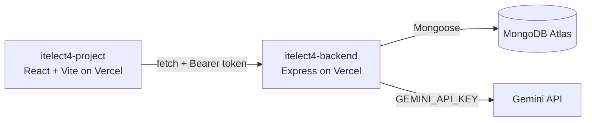

# ITElect4 Lost & Found Backend

Node.js, Express, TypeScript, MongoDB, JWT, Zod, and Gemini AI (`@google/genai`) for the GT6 Lost & Found application.

- **Live API:** https://itelect4-backend-ebon.vercel.app/api/health
- **Frontend repo:** https://github.com/Chylle-prog/itelect4-project

## Architecture

## Live deployment

- Frontend: https://itelect4-project-psi.vercel.app
- Backend: https://itelect4-backend-ebon.vercel.app

## Run locally

1. Install dependencies with `npm install`.
2. Copy `.env.example` to `.env` and set `MONGODB_URI`, a private `JWT_SECRET`, and `GEMINI_API_KEY` from Google AI Studio.
3. Run `npm run dev`; the API listens on port 4000.

Run `npm run build` to type-check the backend. Run `npm run try-ai` to make one real Gemini request from the terminal; it consumes project quota. Never commit `.env` or expose `GEMINI_API_KEY` to the frontend.

## Routes

| Method | Path | Access |
| --- | --- | --- |
| GET | `/api/health` | Public |
| POST | `/api/auth/register` | Public |
| POST | `/api/auth/login` | Public |
| GET | `/api/users` | Bearer token |
| GET | `/api/items` | Bearer token |
| GET | `/api/items/:id` | Bearer token; owner only |
| POST | `/api/items` | Bearer token |
| PATCH | `/api/items/:id` | Bearer token; owner only |
| DELETE | `/api/items/:id` | Bearer token; owner only |
| GET | `/api/claims` | Bearer token; claimant or item owner |
| POST | `/api/claims` | Bearer token |
| PATCH | `/api/claims/:id` | Bearer token; item owner or staff |
| POST | `/api/ai` | Bearer token; five requests per minute per account |

The items and claims collections use MongoDB ObjectIds. Demo users, items, and claims are present in the configured Atlas database. New demo accounts have random passwords and are not login accounts.

## AI route (`POST /api/ai`)

Added in Session 11. Accepts a JSON body `{ "prompt": "<20�2000 chars>" }` with a valid Bearer token and returns a structured review of the submitted lost-and-found report.

**Request schema** (`src/schemas/review.ts`): the `prompt` field is trimmed and must be 20�2000 characters.

**Reply schema** � four fields Gemini is required to fill in:

| Field | Type | Description |
| --- | --- | --- |
| `summary` | `string` | One sentence restating what the student built. |
| `strengths` | `string[]` (1�3 items) | What the description shows was done well. |
| `improvements` | `string[]` (1�3 items) | Concrete things to fix or add before submitting. |
| `readiness` | `"ready" \| "almost" \| "not-yet"` | How close the project is to being submitted. |

The same Zod schema (`reviewSchema`) is used three ways: as the TypeScript type via `z.infer`, as the JSON Schema sent to Gemini via `z.toJSONSchema`, and as the runtime check on Gemini's reply via `safeParse`.

The route is protected by `requireAuth` and an `express-rate-limit` limiter keyed on `req.userId` (5 requests per minute). Error responses:

| Status | Cause |
| --- | --- |
| 400 | Request body failed Zod validation |
| 429 | Gemini's own quota exhausted |
| 429 | Five-per-minute per-account limit hit |
| 502 | Gemini replied but the reply did not match the schema |
| 500 | Unexpected error (see runtime logs) |

**Environment variables**

| Variable | Required | Notes |
| --- | --- | --- |
| `MONGODB_URI` | Yes | Atlas connection string |
| `JWT_SECRET` | Yes | Keep private; never expose to the client |
| `GEMINI_API_KEY` | Yes | From Google AI Studio; add to Vercel project and redeploy after adding |

## Deploying to Vercel

The backend is deployed as a serverless function via `api/index.ts` and `vercel.json`. After adding `GEMINI_API_KEY` in the Vercel project's **Settings > Environment Variables**, open **Deployments**, click the three dots on the latest deployment, and choose **Redeploy** � a new variable is only read when the app starts.

Verify with Postman: `POST /api/ai` with a valid Bearer token and `{ "prompt": "..." }`. A 200 returns all four fields. A 500 means the variable is missing; a 502 means the key is wrong.

## AI-Use Disclosure

AI assistants were utilized during development for code syntax verification, lockfile debugging, and structuring test suites. All application features, schema design, and integrations were reviewed and tested by the author in adherence to course guidelines.
